# Coding Orchestrator (`@coding`)

The `coding` subagent guides software requests through a rigorous, multi-agent development pipeline.

## Workflow Pipeline & Flowchart

```mermaid
flowchart TD
    Start(["User Request / Task"]) --> Phase1["Phase 1: Clarification<br/>(@coding-clarify)"]
    
    Phase1 --> AmbiguityCheck{"Ambiguities or<br/>Open Questions?"}
    AmbiguityCheck -->|"Yes"| GrillUser["Interrogate User via ask_question<br/>(One question at a time)"]
    GrillUser --> AmbiguityCheck
    AmbiguityCheck -->|"No / Clarified"| DocAfterPhase1{"agentic-document-plugin<br/>(or agentic-obsidian-plugin)<br/>installed?"}
    DocAfterPhase1 -->|"Yes"| InvokeDoc1["Invoke @coding-document<br/>(Document requirements & clarification notes)"]
    DocAfterPhase1 -->|"No"| Phase2["Phase 2: Specification<br/>(@coding-specify)"]
    InvokeDoc1 --> Phase2
    
    Phase2 --> SpecArtifact["Write specification.md<br/>(RequestFeedback=True, sole tool call)"]
    SpecArtifact --> IdleGuardSpec["Enter IDLE State<br/>(Wait for User Gate Decision)"]
    IdleGuardSpec --> UserSpecGate{"User Decision on<br/>specification.md?"}
    UserSpecGate -->|"[GATE_REJECTED]"| Phase1
    UserSpecGate -->|"[GATE_APPROVED]"| DocAfterPhase2{"agentic-document-plugin<br/>installed?"}
    DocAfterPhase2 -->|"Yes"| InvokeDoc2["Invoke @coding-document<br/>(Document & index feature specifications)"]
    DocAfterPhase2 -->|"No"| Phase3["Phase 3: Planning<br/>(@coding-plan)"]
    InvokeDoc2 --> Phase3
    
    Phase3 --> PlanArtifact["Write plan.md<br/>(RequestFeedback=True, sole tool call)"]
    PlanArtifact --> IdleGuardPlan["Enter IDLE State<br/>(Wait for User Gate Decision)"]
    IdleGuardPlan --> UserPlanGate{"User Decision on<br/>plan.md?"}
    UserPlanGate -->|"[GATE_REJECTED]"| Phase1
    UserPlanGate -->|"[GATE_APPROVED]"| DocAfterPhase3{"agentic-document-plugin<br/>installed?"}
    DocAfterPhase3 -->|"Yes"| InvokeDoc3["Invoke @coding-document<br/>(Document architecture plan & ADRs)"]
    DocAfterPhase3 -->|"No"| Phase4["Phase 4: Development<br/>(@coding-develop)"]
    InvokeDoc3 --> Phase4
    
    Phase4 --> ParallelDev["Fan out parallel workers<br/>per repo on isolated branches"]
    ParallelDev --> DevWork["Implement code, tests, linting<br/>Return DevelopReport"]
    DevWork --> DocAfterPhase4{"agentic-document-plugin<br/>installed?"}
    DocAfterPhase4 -->|"Yes"| InvokeDoc4["Invoke @coding-document<br/>(Document code changes & implementation notes)"]
    DocAfterPhase4 -->|"No"| Phase5["Phase 5: Review<br/>(@coding-review)"]
    InvokeDoc4 --> Phase5
    
    Phase5 --> AuditChanges["Audit deliverables against spec<br/>Run verification test suites"]
    AuditChanges --> ReviewCheck{"Quality Audit<br/>Passed?"}
    ReviewCheck -->|"Defects Found"| Phase3
    ReviewCheck -->|"Passed"| ConfirmMergeGate{"Confirm Merge with User<br/>(ask_question)"}
    ConfirmMergeGate -->|"User Denied"| AbortWorkflow(["Abort / Terminate"])
    ConfirmMergeGate -->|"User Confirmed"| DocAfterPhase5{"agentic-document-plugin<br/>installed?"}
    DocAfterPhase5 -->|"Yes"| InvokeDoc5["Invoke @coding-document<br/>(Pre-merge tidy-up: update READMEs & architecture docs)"]
    DocAfterPhase5 -->|"No"| Phase6["Phase 6: Merge & Release<br/>(@coding-merge)"]
    InvokeDoc5 --> Phase6
    
    Phase6 --> ExecMerge["Execute git merge or open GitHub PR"]
    ExecMerge --> DocAfterPhase6{"agentic-document-plugin<br/>installed?"}
    DocAfterPhase6 -->|"Yes"| InvokeDoc6["Invoke @coding-document<br/>(Post-merge: update git status, branch tracking & changelogs)"]
    DocAfterPhase6 -->|"No"| Complete(["Workflow Completed"])
    InvokeDoc6 --> Complete
```

1. **`coding-clarify`**:
   - Conducts a Matt Pocock `/grill-me` style interview.
   - Clarifies edge cases, non-goals, and dependencies one question at a time via `ask_question`.
   - **Post-Phase Documentation**: If `agentic-document-plugin` (or `agentic-obsidian-plugin`) is installed, invoke `@coding-document` to record clarified requirements and interview notes.
2. **`coding-specify`**:
   - Synthesizes findings into `specification.md` (Artifact with `RequestFeedback=True` as sole tool call).
   - Awaits interactive user approval in the background (`idle` state).
   - **Idle Guard**: Orchestrator ignores `has gone idle` platform notifications, halts turn execution without calling tools, and awaits explicit subagent approval message.
   - Advances to `coding-plan` ONLY upon receiving explicit `[GATE_APPROVED] specification.md:` message from `coding-specify` (or routes to `coding-clarify` on `[GATE_REJECTED]`).
   - **Post-Phase Documentation**: If `agentic-document-plugin` is installed, invoke `@coding-document` to document and index the approved specification in the vault.
3. **`coding-plan`**:
   - Decomposes work per repository and determines branch names (`feature/*`, `task/*`, `bugfix/*`).
   - Produces `plan.md` (Artifact with `RequestFeedback=True` as sole tool call) and awaits user approval in the background (`idle` state).
   - **Idle Guard**: Orchestrator ignores `has gone idle` platform notifications, halts turn execution without calling tools, and awaits explicit subagent approval message.
   - Advances to `coding-develop` ONLY upon receiving explicit `[GATE_APPROVED] plan.md:` message from `coding-plan` (or routes to `coding-clarify` on `[GATE_REJECTED]`).
   - **Post-Phase Documentation**: If `agentic-document-plugin` is installed, invoke `@coding-document` to document architecture plans and ADRs.
4. **`coding-develop`**:
   - Fanned out in parallel per repository (`coding-develop-<repo>`).
   - Scoped strictly to each repo directory. Writes code, tests, documentation, and verifies linting.
   - **Post-Phase Documentation**: If `agentic-document-plugin` is installed, invoke `@coding-document` to document code changes, implementation notes, and test reports.
5. **`coding-review`**:
   - Collects all develop reports. Confirms cross-repo consistency and spec compliance.
   - If defects found, loops back to `coding-plan`. If approved, asks user for merge confirmation.
   - **Pre-Merge Documentation (Tidy Up)**: If `agentic-document-plugin` is installed, invoke `@coding-document` prior to merging to tidy up project and feature documentation, architecture diagrams, and ADRs.
6. **`coding-merge`**:
   - Automatically merges locally or opens a Pull Request with `gh` if remote exists.
   - **Post-Merge Documentation (Git Status)**: If `agentic-document-plugin` is installed, invoke `@coding-document` at the end to update git status, branch states, and changelogs in the Obsidian vault.

## Interactive Approval Gate & Idle Guard Protocol

- `coding-specify` and `coding-plan` write artifacts (`specification.md`, `plan.md`) with `RequestFeedback=True` as their sole and final tool call, entering `idle` state.
- When Antigravity notifies `Subagent <id> has gone idle`, the orchestrator **MUST NOT** proceed to the next stage. It terminates its turn immediately without calling tools.
- Advancement to Stage 3 or Stage 4 requires an explicit message starting with `[GATE_APPROVED]` (e.g. `[GATE_APPROVED] specification.md:` or `[GATE_APPROVED] plan.md:`).
- Rejection or change requests starting with `[GATE_REJECTED]` route back to `coding-clarify`.

## Triggering the Workflow

- Type `@coding <your feature or task description>`
- Or prompt: "Implement the following feature using the coding workflow: ..."
