# Coding Orchestrator (`@coding`)

The `coding` subagent guides software requests through a rigorous, multi-agent development pipeline.

## Workflow Pipeline & Flowchart

```mermaid
flowchart TD
    %% Top Entrypoint
    Start(["User Request / Task"]) --> P1["Phase 1: Clarification<br/>(@coding-clarify)"]
    
    %% Phase 1: Clarification
    P1 --> AmbiguityCheck{"Ambiguities or<br/>Open Questions?"}
    AmbiguityCheck -->|"Yes"| GrillUser["Relay Question to User<br/>([QUESTION_RELAY_REQUEST] -> ask_question<br/>-> [QUESTION_RELAY_RESPONSE])"]
    GrillUser --> P1
    AmbiguityCheck -->|"No / Clarified"| P2["Phase 2: Specification<br/>(@coding-specify)"]

    %% Phase 2: Specification
    P2 --> SpecArtifact["Write specification.md<br/>(RequestFeedback=True, sole tool call)"]
    SpecArtifact --> IdleSpec["Enter IDLE State<br/>(Wait for User Gate Decision)"]
    IdleSpec --> SpecGate{"User Decision on<br/>specification.md?"}
    SpecGate -->|"[GATE_APPROVED]"| P3["Phase 3: Planning<br/>(@coding-plan)"]

    %% Phase 3: Planning
    P3 --> PlanArtifact["Write plan.md<br/>(RequestFeedback=True, sole tool call)"]
    PlanArtifact --> IdlePlan["Enter IDLE State<br/>(Wait for User Gate Decision)"]
    IdlePlan --> PlanGate{"User Decision on<br/>plan.md?"}
    PlanGate -->|"[GATE_APPROVED]"| DocPlanCheck{"agentic-project-documenting-plugin<br/>installed?"}
    DocPlanCheck -->|"Yes"| InvokeDocPlan["Invoke @coding-document<br/>(Document architecture plan & ADRs)"]
    DocPlanCheck -->|"No"| P4["Phase 4: Development<br/>(@coding-develop)"]
    InvokeDocPlan --> P4

    %% Phase 4: Development & Phase 5: Local Deployment (Per-Repo)
    P4 --> ParallelDev["Fan out parallel workers<br/>per repo on isolated branches"]
    ParallelDev --> DevWork["Implement code, tests, linting<br/>Return DevelopReport"]
    DevWork --> DeployCheck{"Local deployment<br/>instructions exist?"}
    DeployCheck -->|"Yes"| P5Deploy["Phase 5: Local Deployment<br/>(@coding-deploy per repo)"]
    DeployCheck -->|"No"| JoinDevDeploy["Synchronize Deliverables<br/>(All develop & deploy done)"]

    %% Phase 5: Deployment Execution, Monitoring & Error Loop
    P5Deploy --> DeployRun["Execute local deploy & monitor health"]
    DeployRun --> DeploySuccess{"Deployment<br/>Successful?"}
    DeploySuccess -->|"Yes"| JoinDevDeploy
    DeploySuccess -->|"Error"| DeployIssueArtifact["Investigate error & author<br/>Deployment Issue artifact<br/>(RequestFeedback=True)"]
    DeployIssueArtifact --> DeployGate{"User Decision on<br/>Deployment Issue?"}
    DeployGate -->|"Approved"| MultiSolCheck{"Multiple solutions<br/>proposed?"}
    MultiSolCheck -->|"Yes"| AskSol["Relay solution choice<br/>([QUESTION_RELAY_REQUEST] -> ask_question<br/>-> [QUESTION_RELAY_RESPONSE])"]
    MultiSolCheck -->|"Single"| InvokeFixDev["Invoke @coding-develop<br/>to implement fix"]
    AskSol --> InvokeFixDev
    InvokeFixDev --> P5Deploy
    DeployGate -->|"Rejected"| AbortWorkflow(["Abort / Terminate"])

    %% Phase 6: Review
    JoinDevDeploy --> P6Review["Phase 6: Review<br/>(@coding-review)"]
    P6Review --> AuditChanges["Audit deliverables & deployment<br/>Run verification test suites"]
    AuditChanges --> ReviewCheck{"Quality Audit<br/>Passed?"}
    ReviewCheck -->|"Passed"| MergeConfirmGate{"Confirm Merge with User<br/>(ask_question directly or relayed)"}
    MergeConfirmGate -->|"User Confirmed"| DocPreMergeCheck{"agentic-project-documenting-plugin<br/>installed?"}
    DocPreMergeCheck -->|"Yes"| InvokeDocPreMerge["Invoke @coding-document<br/>(Pre-merge tidy-up: update READMEs & architecture docs)"]
    DocPreMergeCheck -->|"No"| P7Merge["Phase 7: Merge & Release<br/>(@coding-merge)"]
    InvokeDocPreMerge --> P7Merge

    %% Phase 7: Release & Merge
    P7Merge --> ExecMerge["Wait for all develop & deploy<br/>Execute git merge or open GitHub PR"]
    ExecMerge --> DocPostMergeCheck{"agentic-project-documenting-plugin<br/>installed?"}
    DocPostMergeCheck -->|"Yes"| InvokeDocPostMerge["Invoke @coding-document<br/>(Post-merge: update git status, branch tracking & changelogs)"]
    DocPostMergeCheck -->|"No"| Complete(["Workflow Completed"])
    InvokeDocPostMerge --> Complete

    %% Rejection & Rework Loops (routing upward)
    SpecGate -->|"[GATE_REJECTED]"| P1
    PlanGate -->|"[GATE_REJECTED]"| P1
    ReviewCheck -->|"Defects Found"| P3

    %% User Denied Merge routes directly to bottom termination
    MergeConfirmGate -->|"User Denied"| AbortWorkflow
```



1. **`coding-clarify`**:
   - Conducts a Matt Pocock `/grill-me` style interview.
   - Clarifies edge cases, non-goals, and dependencies one question at a time using the Question Relay Protocol (`[QUESTION_RELAY_REQUEST]` / `[QUESTION_RELAY_RESPONSE]`).
   - Advances directly to `coding-specify` once all ambiguities are resolved.
2. **`coding-specify`**:
   - Synthesizes findings into `specification.md` (Artifact with `RequestFeedback=True` as sole tool call).
   - Awaits interactive user approval in the background (`idle` state).
   - **Idle Guard**: Orchestrator ignores `has gone idle` platform notifications, halts turn execution without calling tools, and awaits explicit subagent approval message.
   - Advances to `coding-plan` ONLY upon receiving explicit `[GATE_APPROVED] specification.md:` message from `coding-specify` (or routes to `coding-clarify` on `[GATE_REJECTED]`).
3. **`coding-plan`**:
   - Decomposes work per repository and determines branch names (`feature/*`, `task/*`, `bugfix/*`).
   - Assesses if local deployment is required for each repository (Docker, Docker Compose, Terraform to local Kubernetes/Minikube, scripts).
   - Produces `plan.md` (Artifact with `RequestFeedback=True` as sole tool call) and awaits user approval in the background (`idle` state).
   - **Idle Guard**: Orchestrator ignores `has gone idle` platform notifications, halts turn execution without calling tools, and awaits explicit subagent approval message.
   - Advances to `coding-develop` ONLY upon receiving explicit `[GATE_APPROVED] plan.md:` message from `coding-plan` (or routes to `coding-clarify` on `[GATE_REJECTED]`).
   - **Post-Plan Approval Documentation**: If `agentic-project-documenting-plugin` is installed, invoke `@coding-document` after plan approval to document architecture plans, work breakdowns, and formalize ADRs.
4. **`coding-develop`**:
   - Fanned out in parallel per repository (`coding-develop-<repo>`).
   - Scoped strictly to each repo directory. Writes code, tests, documentation, and verifies linting.
   - Generates `DevelopReport`. Triggers `coding-deploy` immediately for repos with local deployment instructions.
5. **`coding-deploy`**:
   - Runs local deployment and actively monitors container health, pod states, and service endpoints.
   - On error, diagnoses root cause, creates `Deployment Issue` artifact (`deployment-issue.md`, `RequestFeedback=True`), and awaits user approval.
   - If approved with multiple options, relays question to the user via `[QUESTION_RELAY_REQUEST]`.
   - Invokes `coding-develop` to implement the approved fix, then re-deploys and monitors.
6. **`coding-review`**:
   - Collects all develop and deploy reports. Confirms cross-repo consistency, spec compliance, and local deployment health.
   - If defects found, loops back to `coding-plan`. If approved, requests merge confirmation directly or via `[QUESTION_RELAY_REQUEST]`.
   - **Pre-Merge Documentation (Tidy Up)**: If `agentic-project-documenting-plugin` is installed, invoke `@coding-document` prior to merging to tidy up project and feature documentation, architecture diagrams, and ADRs.
7. **`coding-merge`**:
   - Waits for all `coding-develop` and all `coding-deploy` to complete successfully.
   - Automatically merges locally or opens a Pull Request with `gh` if remote exists.
   - **Post-Merge Documentation (At the End)**: If `agentic-project-documenting-plugin` is installed, invoke `@coding-document` at the end to update git status, branch states, and changelogs in the Obsidian vault.

## Question Relay Protocol & Subagent Timeout Mitigation

Worker subagents do not execute interactive user prompts directly when managed by `@coding`. Instead, they delegate interactive user queries to the parent orchestrator using structured message contracts:

### 1. Protocol Contracts
- **Relay Request (`Subagent -> @coding`)**:
  ```text
  [QUESTION_RELAY_REQUEST]
  Question: <Question text>
  Options:
  - (Recommended) Option 1: <Description>
  - Option 2: <Description>
  Context: <Rationale and background>
  ```
- **Relay Response (`@coding -> Subagent`)**:
  ```text
  [QUESTION_RELAY_RESPONSE]
  Answer: <selected_option_or_text>
  ```

### 2. Orchestrator Handling & Timeout Mitigation Patterns
1. **Interactive Prompt Handling**: Upon receiving `[QUESTION_RELAY_REQUEST]`, the orchestrator parses the question, options, and context, calls `ask_question` at the top level, and immediately sends `[QUESTION_RELAY_RESPONSE]` with the user's answer back to the subagent.
2. **Subagent Timeout Mitigation**:
   - Subagents blocked on interactive user questions risk timeouts or UI occlusion when running nested under orchestrators.
   - Elevating questions to the session root orchestrator ensures prompt rendering is visible to the user and avoids subagent timeouts.
   - Subagents maintain execution state cleanly, awaiting the single `[QUESTION_RELAY_RESPONSE]` message.
3. **Standalone Fallback**: Subagents maintain a fallback to invoke `ask_question` directly when invoked standalone outside of the `@coding` orchestrator.

## Interactive Approval Gate & Idle Guard Protocol

- `coding-specify`, `coding-plan`, and `coding-deploy` write artifacts (`specification.md`, `plan.md`, `deployment-issue.md`) with `RequestFeedback=True` as their sole and final tool call, entering `idle` state.
- When Antigravity notifies `Subagent <id> has gone idle`, the orchestrator **MUST NOT** proceed to the next stage. It terminates its turn immediately without calling tools.
- Advancement to Stage 3 or Stage 4 requires an explicit message starting with `[GATE_APPROVED]` (e.g. `[GATE_APPROVED] specification.md:` or `[GATE_APPROVED] plan.md:`).
- Rejection or change requests starting with `[GATE_REJECTED]` route back to `coding-clarify`.

## Triggering the Workflow

- Type `@coding <your feature or task description>`
- Or prompt: "Implement the following feature using the coding workflow: ..."
